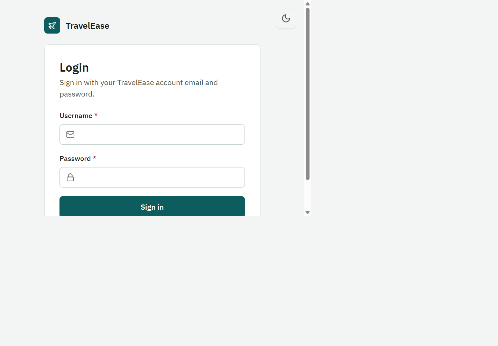
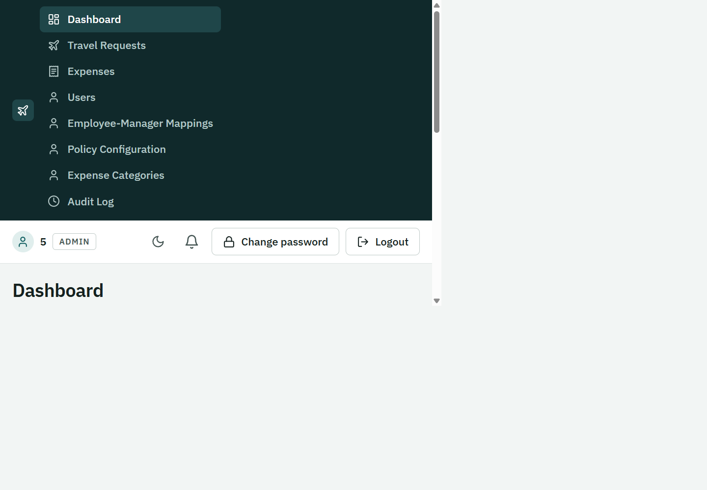
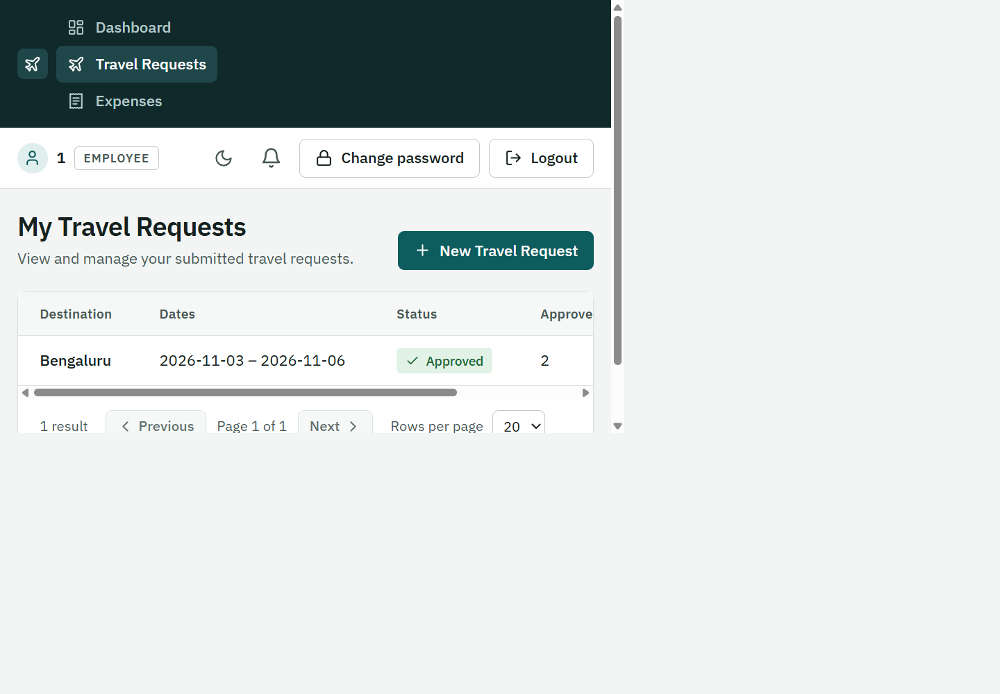
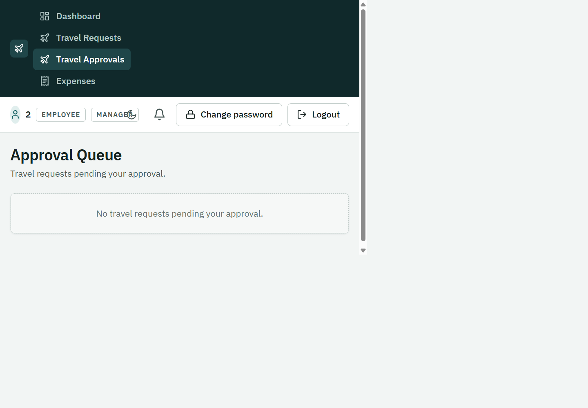
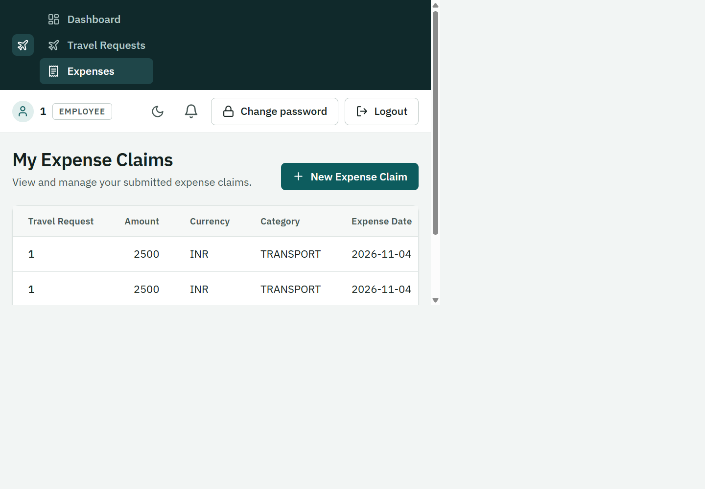
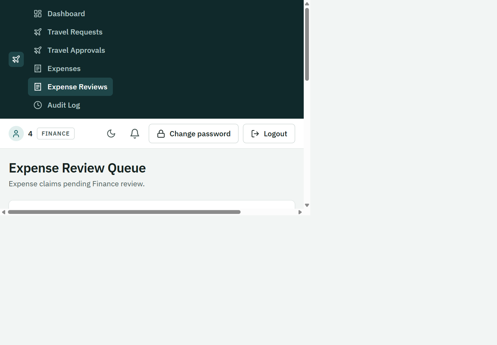
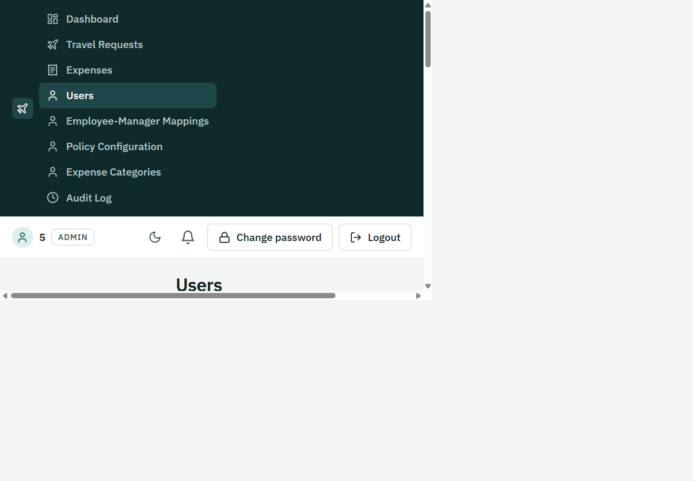
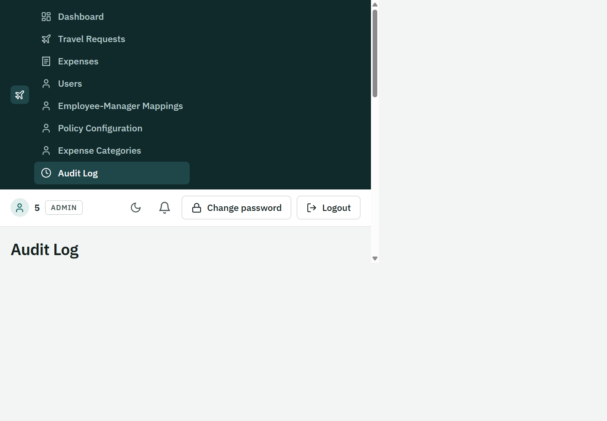

# TravelEase

TravelEase is a travel and expense management application for employees, managers, Finance, and administrators. Employees submit travel requests and expense claims, managers approve travel, Finance reviews and reimburses expenses, and administrators manage users and policy data.

The project is a React + TypeScript frontend backed by Spring Boot services, a Spring Cloud Gateway, and MySQL.

## Features

- Role-aware dashboard and navigation for **EMPLOYEE**, **MANAGER**, **FINANCE**, and **ADMIN**.
- Create, edit, submit, review, approve, and track travel requests.
- Create and track expense claims, attach receipts, review claims, detect duplicates, and record reimbursements.
- Manage user accounts, employee-manager mappings, expense categories, and policy configuration.
- Browse audit events and in-app notifications.
- JWT authentication, role-based authorization, password-change flows, and session-expiry handling.
- Light and dark themes, paginated lists, validation, and CSV export.

## Screenshots

Selected screens showcasing the main user workflows:

| Login | Dashboard |
|---|---|
|  |  |

| Travel requests | Travel approvals |
|---|---|
|  |  |

| Expense claims | Finance review queue |
|---|---|
|  |  |

| Administration | Audit log |
|---|---|
|  |  |

## Architecture

The browser calls the gateway through the frontend's `/api` proxy. The gateway routes requests to the appropriate service. Each database-backed service owns its schema and applies its Flyway migrations at startup.

| Module | Local port | Responsibility |
|---|---:|---|
| `frontend` | 5173 | React UI, served locally by Vite |
| `gateway-service` | 9001 | API routing and CORS |
| `admin-service` | 8082 | Authentication, users, roles, policies, and mappings |
| `travel-request-service` | 8081 | Travel requests, approvals, and travel documents |
| `expense-service` | 8086 | Expense claims, reviews, receipts, and reimbursements |
| `audit-service` | 8084 | Audit events |
| `notification-service` | 8085 | In-app notifications and optional email delivery |
| `common-lib` | — | Shared security, audit, and service infrastructure |

MySQL schemas (created automatically if the database account has permission):

`travelease_admin`, `travelease_travelrequest`, `travelease_expence`, `travelease_audit`, and `travelease_notification`.

> The `travelease_expence` schema name is intentionally spelled this way in the current application configuration.

## Prerequisites

- JDK 17 or newer
- Maven 3.9 or newer
- Node.js 20.19+ (or 22.12+) and npm
- MySQL 8 or newer

Confirm that Maven is using Java 17+ with `mvn -version`. On Windows, `java -version` and Maven may resolve to different Java installations.

## Run locally

### 1. Create a MySQL database user

The application connects to MySQL at `localhost:3306` by default. You can create a dedicated local account and the five schemas in MySQL Workbench or the MySQL command line. Replace the example password with your own:

```sql
CREATE DATABASE IF NOT EXISTS travelease_admin;
CREATE DATABASE IF NOT EXISTS travelease_travelrequest;
CREATE DATABASE IF NOT EXISTS travelease_expence;
CREATE DATABASE IF NOT EXISTS travelease_audit;
CREATE DATABASE IF NOT EXISTS travelease_notification;

CREATE USER IF NOT EXISTS 'travelease_app'@'localhost'
  IDENTIFIED BY 'replace-with-a-local-password';

GRANT ALL PRIVILEGES ON travelease_admin.* TO 'travelease_app'@'localhost';
GRANT ALL PRIVILEGES ON travelease_travelrequest.* TO 'travelease_app'@'localhost';
GRANT ALL PRIVILEGES ON travelease_expence.* TO 'travelease_app'@'localhost';
GRANT ALL PRIVILEGES ON travelease_audit.* TO 'travelease_app'@'localhost';
GRANT ALL PRIVILEGES ON travelease_notification.* TO 'travelease_app'@'localhost';
```

The services create their schemas if needed, but the MySQL user must have permission to create databases. If you grant access only to pre-created schemas, that is sufficient.

### 2. Configure the backend

From the project root, copy the example file and edit the local copy:

```powershell
Copy-Item .\backend\.env.example .\backend\.env
notepad .\backend\.env
```

Set `TRAVELEASE_DB_USERNAME` and `TRAVELEASE_DB_PASSWORD` to the MySQL account you created. Set two **different** secrets of at least 32 bytes for `TRAVELEASE_JWT_SECRET` and `TRAVELEASE_INTERNAL_SECRET`. You can generate each with:

```powershell
node -e "console.log(require('node:crypto').randomBytes(48).toString('base64'))"
```

Keep the generated values private. `backend/.env` is local configuration and must not be committed. The example template also documents optional storage, bootstrap-admin, and SMTP settings. Email is off by default.

### 3. Build the backend

Run this once from the project root:

```powershell
Set-Location .\backend
mvn -B clean package -DskipTests
```

For the full backend test suite instead, run `mvn -B clean verify` from `backend`.

### 4. Start the backend services

Run each command in its **own terminal** from the project root. The development profile enables sample accounts and sample travel/expense data for the admin, travel-request, and expense services. Flyway applies migrations on startup.

```powershell
# Terminal 1 — admin service
Set-Location .\backend\admin-service
java -jar .\target\admin-service-1.0.0-SNAPSHOT.jar --spring.profiles.active=dev
```

```powershell
# Terminal 2 — travel-request service
Set-Location .\backend\travel-request-service
java -jar .\target\travel-request-service-1.0.0-SNAPSHOT.jar --spring.profiles.active=dev
```

```powershell
# Terminal 3 — expense service
Set-Location .\backend\expense-service
java -jar .\target\expense-service-1.0.0-SNAPSHOT.jar --spring.profiles.active=dev
```

```powershell
# Terminal 4 — audit service
Set-Location .\backend\audit-service
java -jar .\target\audit-service-1.0.0-SNAPSHOT.jar
```

```powershell
# Terminal 5 — notification service
Set-Location .\backend\notification-service
java -jar .\target\notification-service-1.0.0-SNAPSHOT.jar
```

```powershell
# Terminal 6 — gateway (start after the services above)
Set-Location .\backend\gateway-service
java -jar .\target\gateway-service-1.0.0-SNAPSHOT.jar
```

Wait for each service to log that it has started. Keep these terminals open while using the app. Press **Ctrl+C** in each terminal to stop its service.

### 5. Start the frontend

In another terminal:

```powershell
Set-Location .\frontend
npm ci
npm run dev
```

Open **http://localhost:5173**. The Vite development server proxies `/api` requests to `http://127.0.0.1:9001`.

### Demo accounts

The development seeder creates these accounts on an empty database. The default development password is `TravelEase123!` for each account; it can be overridden with `TRAVELEASE_SEED_PASSWORD` before starting the admin service.

| Role | Username |
|---|---|
| Employee | `asha.rao@infy.com` |
| Manager | `rahul.mehta@infy.com` |
| Manager | `priya.nair@infy.com` |
| Finance | `finance.desk@infy.com` |
| Admin | `sam.admin@infy.com` |
| Employee | `alice.employee@travelease.com` |

Demo seeding is create-only: it does not reset or overwrite an account that already exists. These development credentials must not be used in a deployed environment.

## Tests and checks

Frontend:

```powershell
Set-Location .\frontend
npm ci
npm run lint
npm run test:run
npm run build
```

Backend, from the `backend` directory:

```powershell
mvn -B clean verify
```

## Security and local data

- Never commit `backend/.env`, real credentials, JWT secrets, or uploaded documents.
- Demo seeding is intended for local development only. Do not enable the `dev` profile in production.
- Production runs require secure secrets and a persistent document-storage directory; configure them through the deployment environment or secret manager.
- Flyway owns database schema changes. Hibernate validates the schema rather than modifying it.
- Uploaded travel and expense documents are limited to 5 MB per file.
- Email notifications require a real SMTP configuration and remain disabled by default.

## Repository layout

```text
backend/
  common-lib/
  gateway-service/
  admin-service/
  travel-request-service/
  expense-service/
  audit-service/
  notification-service/
frontend/
  src/
  public/
screenshots/
```
